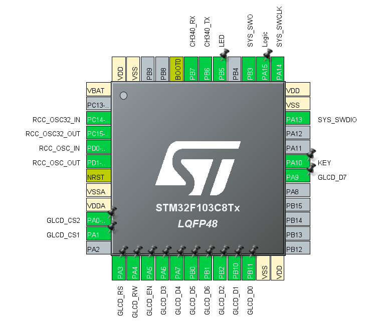
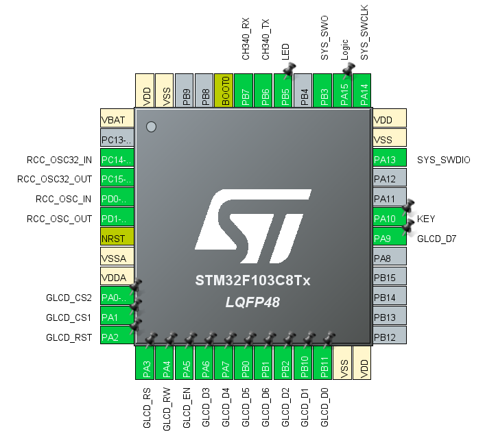

# GLCD Library - API Reference

This library provides a complete driver for 128×64 graphical LCD modules based on the KS0108 controller (two controller chips, one per half of the screen). It supports text with a built-in 5×8 font, inverted text, full-screen bitmaps, data graphs, a progress bar, and a loading-dots animation.

The library talks to the display over an 8-bit parallel interface and is written on top of the STM32 HAL. It uses **no frame buffer**: everything is written directly to the display, so it needs essentially no RAM.

## Source Files

```
STM32_HAL_GLCD_GPIO
└── source/
    ├── glcd.h
    └── glcd.c
```

---

## Display Organization

Understanding how the KS0108 organizes its memory makes every function below easier to use.

### Two Controller Chips

The 128×64 panel is split into two 64×64 halves, each driven by its own KS0108 chip:

| Chip | Chip-select pin | Columns (X) |
|------|-----------------|-------------|
| Left  | `GLCD_CS1` | 0 – 63 |
| Right | `GLCD_CS2` | 64 – 127 |

The library selects the correct chip automatically for every column. You always work with a single 0–127 X coordinate.

### Pages

The 64 rows are grouped into **8 pages** of 8 pixels each. A byte written to the display fills **one column of one page** (8 vertical pixels):

- Bit 0 (LSB) is the **top** pixel of the page
- Bit 7 (MSB) is the **bottom** pixel of the page
- After each data write, the column address advances automatically

### Two Coordinate Systems

| System | Used by | X range | Y range |
|--------|---------|---------|---------|
| **Pixel** | `glcd_gotoxy()` | 0 – 127 | 0 – 63 |
| **Character cell** | `glcd_gotocr()`, `glcd_dots()` | 0 – 20 (column) | 0 – 7 (row) |

Each character cell is **6 pixels wide** (5 pixel font + 1 pixel spacing) and **8 pixels tall** (one page), which gives 21 characters per line and 8 lines.

> [!NOTE]
> Text is always aligned to a page boundary vertically. If you pass a Y pixel value that is not a multiple of 8 to `glcd_gotoxy()`, it is rounded down to the start of its page.

---

## Hardware Pin Configuration

You can assign the GLCD pins to any free GPIO pins of your STM32 by setting their **User Labels** in STM32CubeMX.

**You MUST configure all GLCD pins in STM32CubeMX before using this library.** CubeMX generates the `GLCD_xxx_GPIO_Port` and `GLCD_xxx_Pin` definitions in `main.h` from the User Labels.

### CubeMX Configuration Steps

1. Open the **Pinout & Configuration** tab
2. Select the GPIO pins you want to use
3. Set the pin mode to `GPIO_Output`
4. Set the output type to `Push Pull`
5. Set the output speed to `Low` or `Medium`
6. Enter the exact User Labels listed below
7. Generate the code

### Required User Labels

| GLCD Pin | User Label | Description |
|----------|------------|-------------|
| RS (D/I) | `GLCD_RS`  | Register select: command / data |
| EN (E)   | `GLCD_EN`  | Enable (latch) pulse |
| CS1      | `GLCD_CS1` | Chip select for the left half |
| CS2      | `GLCD_CS2` | Chip select for the right half |
| DB0      | `GLCD_D0`  | Data bit 0 |
| DB1      | `GLCD_D1`  | Data bit 1 |
| DB2      | `GLCD_D2`  | Data bit 2 |
| DB3      | `GLCD_D3`  | Data bit 3 |
| DB4      | `GLCD_D4`  | Data bit 4 |
| DB5      | `GLCD_D5`  | Data bit 5 |
| DB6      | `GLCD_D6`  | Data bit 6 |
| DB7      | `GLCD_D7`  | Data bit 7 |

**Total: 12 GPIO pins.**




### Other Module Pins

| Module Pin | Connection |
|------------|------------|
| RW | Connect to **GND**. The library is write-only and never reads from the display |
| RST | Connect to **VCC** (or to an RC reset circuit). The reset block in `glcd_Init()` is commented out. To drive reset from the MCU, add a `GLCD_RST` label and uncomment that block |
| VEE / contrast | Wire the contrast potentiometer according to your module's datasheet |
| Backlight (A / K) | Not controlled by this library. Power it through a suitable current-limiting resistor (or your own transistor circuit) |



### Chip-Select Polarity

> [!IMPORTANT]
> The library drives CS1 and CS2 as **active HIGH** (pin SET = chip selected). Many 128-64 modules label their pins `CS1`/`CS2` (active high), while others label them `/CS1`/`/CS2` (active low). Check your module's datasheet.
>
> The `__GLCD_ChipSelectType` macro in `glcd.h` documents this setting, but the current implementation in `glcd.c` hard-codes the active-high behavior. For an active-low module, swap `GPIO_PIN_SET` and `GPIO_PIN_RESET` for the CS1/CS2 writes in `glcd_Init()` and `goto_col()`.

---

## Configuration Constants

These constants are defined in `glcd.h`.

| Constant | Default | Description |
|----------|---------|-------------|
| `__GLCD_ChipSelectType` | `HIGH` | Chip-select polarity (`HIGH` = active high). See the note above |
| `__GLCD_Dlay_Factor` | `1` | Delay multiplier for timing adjustments |
| `__GLCD_Init_Delay` | `1000` | Delay between initialization commands, in µs |
| `__GLCD_WIDTH` | `128` | Display width in pixels |
| `__GLCD_HEIGHT` | `64` | Display height in pixels |

### Command Definitions

| Constant | Value | Description |
|----------|-------|-------------|
| `__glcd_writeCmd` | `0` | RS level for commands |
| `__glcd_writeData` | `1` | RS level for data |
| `__glcd_DISPLAY_ON` | `0x3F` | Turn the display ON |
| `__glcd_DISPLAY_OFF` | `0x3E` | Turn the display OFF |
| `__glcd_DISPLAY_Start` | `0xC0` | Set display start line |
| `__glcd_Command_Set_Address` | `0x40` | Set column (Y address inside the chip) |
| `__glcd_Command_Set_Page` | `0xB8` | Set page (X address inside the chip) |
| `__glcd_Command_Display_Start` | `0xC0` | Set display start line |

---

## Dependencies

The library includes `aKaReZa.h` (see [STM32_RawProject_HAL](https://github.com/aKaReZa75/STM32_RawProject_HAL)), which provides:

- The STM32 HAL headers
- `bitCheck()` and the `bool` / `HIGH` / `LOW` definitions
- `delay_us()`, the microsecond delay function used for all GLCD timing

If `aKaReZa.h` is missing, the compiler stops with an explicit error message.

---

## API Functions

### Initialization

#### `void glcd_Init(void)`

**Description:**  
Initializes the GLCD. This function **must be called first** before using any other GLCD function.

**Operation:**
- Puts the control pins in a safe state (both chips deselected, EN low, RS in command mode)
- Turns the display ON on the left chip, then sets its display start line
- Turns the display ON on the right chip, then sets its display start line
- Clears the entire display
- Moves the cursor to (0, 0)

**Parameters:**  
None

**Returns:**  
None

**Example:**
```c
#include "aKaReZa.h"
#include "glcd.h"

int main(void)
{
    HAL_Init();
    SystemClock_Config();
    MX_GPIO_Init();

    glcd_Init(); // Must be called first

    while(1)
    {
        // Main loop
    }
}
```

> [!IMPORTANT]
> Call `glcd_Init()` only after `MX_GPIO_Init()`. The pins must already be configured as outputs.

---

### Cursor Control

#### `void glcd_gotoxy(uint8_t x, uint8_t y)`

**Description:**  
Moves the cursor to a pixel position.

**Parameters:**
- `x` - Pixel column (0 to 127)
- `y` - Pixel row (0 to 63)

**Returns:**  
None

**Behavior:**
- Values outside the display are clamped to the last valid pixel
- `y` is converted to a page number (`y / 8`), so text always starts at a page boundary

**Examples:**
```c
glcd_gotoxy(0, 0);     // Top-left corner
glcd_gotoxy(64, 0);    // Start of the right half, top line
glcd_gotoxy(10, 24);   // Page 3 (rows 24-31), 10 pixels from the left
```

---

#### `void glcd_gotocr(uint8_t c, uint8_t r)`

**Description:**  
Moves the cursor by character column and row, based on the 6×8 character cell.

**Parameters:**
- `c` - Character column (0 to 20, 21 columns)
- `r` - Character row / page (0 to 7)

**Returns:**  
None

**Behavior:**  
Values outside the range are clamped to the last valid column / row.

**Examples:**
```c
glcd_gotocr(0, 0);    // First character of the first line
glcd_gotocr(5, 3);    // Sixth character of the fourth line
glcd_gotocr(20, 7);   // Last character of the last line
```

> [!NOTE]
> The header comment for this function mentions columns 0 to 21, but the code clamps the column to **20** (128 / 6 = 21 columns, indexed from 0).

---

#### `void goto_col(uint8_t x)`

**Description:**  
Low-level function that selects the correct controller chip for column `x` and sends the column-address command.

**Parameters:**
- `x` - Column (0 to 127)

**Returns:**  
None

**Behavior:**
- Columns 0-63 enable `CS1` and disable `CS2`
- Columns 64-127 enable `CS2`, disable `CS1`, and use `x - 64` as the address inside the chip

> [!NOTE]
> You normally do not need this function. It is public because the other functions of the library use it.

---

#### `void goto_row(uint8_t y)`

**Description:**  
Low-level function that sends the page-address command.

**Parameters:**
- `y` - Page (0 to 7)

**Returns:**  
None

> [!NOTE]
> You normally do not need this function. Always call `goto_col()` first, because it selects the chip that receives the page command.

---

### Low-Level Write

#### `void glcd_write(uint8_t _glcd_value, bool _glcd_cmdData)`

**Description:**  
Sends one command or data byte to the display.

**Parameters:**
- `_glcd_value` - The byte to send
- `_glcd_cmdData` - Byte type selector
  - `__glcd_writeCmd` (0): send as a command
  - `__glcd_writeData` (1): send as display data

**Returns:**  
None

**Operation:**
1. Sets RS for command or data
2. Places the byte on D0-D7
3. Generates the EN pulse (EN high, then low)

**Examples:**
```c
// Write a column of 8 pixels (every other pixel on) at the current position
glcd_write(0x55, __glcd_writeData);

// Turn the currently selected chip off
glcd_write(__glcd_DISPLAY_OFF, __glcd_writeCmd);
```

> [!NOTE]
> The chip that receives the byte is the one selected by the last `goto_col()` call. For normal use, rely on the higher-level functions below.

---

### Clearing

#### `void glcd_clear(void)`

**Description:**  
Clears the entire display and moves the cursor to (0, 0).

**Parameters:**  
None

**Returns:**  
None

**Example:**
```c
glcd_clear();
```

---

#### `void glcd_clrln(uint8_t ln)`

**Description:**  
Clears one text line (one page) across the full width of the display.

**Parameters:**
- `ln` - Line (page) number to clear (0 to 7)

**Returns:**  
None

**Behavior:**  
After clearing, the cursor is placed at the start of line `ln`.

**Example:**
```c
glcd_clrln(2);        // Erase the third line
glcd_puts("Updated"); // Write new text at its start
```

> [!WARNING]
> `ln` is not range-checked. Pass a value between 0 and 7.

---

### Text Display

The built-in font is a **5×8 pixel ASCII font** (character codes 0 to 127). Codes 0-31 are blank. Each character occupies 6 pixels including 1 pixel of spacing.

#### `void glcd_putc(uint8_t c)`

**Description:**  
Displays one character at the current cursor position and advances the cursor.

**Parameters:**
- `c` - ASCII character (0 to 127)

**Returns:**  
None

**Behavior:**
- Characters above 127 are ignored
- If the character does not fit on the current line, the cursor moves to the start of the next line
- After the last line (page 7), the cursor wraps back to the first line (page 0)
- Control characters such as `'\n'` are **not** interpreted

**Examples:**
```c
glcd_gotocr(0, 0);
glcd_putc('A');
glcd_putc('9');
glcd_putc(' ');
```

---

#### `void glcd_puts(const char *s)`

**Description:**  
Displays a null-terminated string starting at the current cursor position.

**Parameters:**
- `s` - Pointer to a null-terminated string

**Returns:**  
None

**Examples:**
```c
glcd_gotocr(0, 0);
glcd_puts("Hello, GLCD!");

glcd_gotocr(0, 1);
char msg[] = "STM32 MCU";
glcd_puts(msg);
```

---

#### `void glcd_putc_inv(uint8_t c)`

**Description:**  
Displays one character in **inverted** form (light text on a dark block) and advances the cursor.

**Parameters:**
- `c` - ASCII character (0 to 127)

**Returns:**  
None

**Behavior:**  
Same cursor and wrapping behavior as `glcd_putc()`. The 1-pixel spacing column is also inverted, so consecutive inverted characters form a continuous block.

---

#### `void glcd_puts_inv(const char *s)`

**Description:**  
Displays a null-terminated string in inverted form.

**Parameters:**
- `s` - Pointer to a null-terminated string

**Returns:**  
None

**Example:**
```c
glcd_gotocr(0, 0);
glcd_puts_inv(" MENU ");        // Highlighted title bar
glcd_gotocr(0, 2);
glcd_puts("Item 1");
```

> [!TIP]
> Use `glcd_puts_inv()` to highlight the selected entry of a menu.

**Displaying numbers:**
```c
#include <stdio.h>

char buffer[22];
float temperature = 25.4f;

sprintf(buffer, "Temp: %.1f C", temperature);
glcd_gotocr(0, 0);
glcd_puts(buffer);
```

---

### Graphics

#### `void glcd_pic(const uint8_t *glcd_pic)`

**Description:**  
Displays a full-screen 128×64 bitmap.

**Parameters:**
- `glcd_pic` - Pointer to **1024 bytes** of bitmap data

**Returns:**  
None

**Data Format:**
- The array is organized page by page: `index = page * 128 + column`
- Each byte is one column of 8 vertical pixels
- Bit 0 is the top pixel, bit 7 is the bottom pixel

**Example:**
```c
const uint8_t logo[1024] =
{
    0x00, 0x00, 0xF8, 0xFC, /* ... 1024 bytes in total ... */
};

glcd_pic(logo);
```

> [!TIP]
> Bitmap converters such as **Image2GLCD** or **LCD Assistant** or [image2cpp](https://javl.github.io/image2cpp/) can generate the array. Choose a **vertical** byte orientation (8 pixels per byte, scanning down the columns), with the least significant bit at the top. If your image appears scrambled or rotated, the byte orientation is the first thing to check.

---

#### `void glcd_draw_graph(const uint8_t *buffer)`

**Description:**  
Clears the display and plots a 128-sample buffer as a graph of dots.

**Parameters:**
- `buffer` - Pointer to an array of **128 bytes**; each value is a height between 0 and 63

**Returns:**  
None

**Behavior:**
- The index of the array is the X position (0-127)
- The value is the height measured from the **bottom** of the screen (0 = bottom, 63 = top)
- Values above 63 are clamped to 63
- A `NULL` pointer is ignored
- One dot is drawn per column

**Example:**
```c
#include <math.h>

uint8_t samples[128];

for(uint8_t i = 0; i < 128; i++)
{
    samples[i] = 32 + (int8_t)(30.0f * sinf(i * 6.2832f / 128.0f)); // One sine period
}

glcd_draw_graph(samples);
```

---

#### `void glcd_draw_graph_minmax(const uint8_t *buffer, uint8_t min_val, uint8_t max_val)`

**Description:**  
Same as `glcd_draw_graph()`, and additionally draws two **dashed horizontal reference lines** at the given minimum and maximum levels.

**Parameters:**
- `buffer` - Pointer to an array of **128 bytes**; each value is a height between 0 and 63
- `min_val` - Minimum reference level (0-63)
- `max_val` - Maximum reference level (0-63)

**Returns:**  
None

**Behavior:**
- Values above 63 are clamped to 63
- The reference lines are dashed (every second pixel) so they stay distinguishable from the data
- Where the graph touches a reference level, the dash is skipped at that column and at the columns right before and after it, so the line does not merge with the curve
- The **max line** is not drawn when `max_val` is `63` or `0`
- The **min line** is not drawn when `min_val` is `0` or `63`
- A `NULL` pointer is ignored
- No local frame buffer is used. Each byte is computed on the fly, which keeps RAM usage minimal

**Example:**
```c
glcd_draw_graph_minmax(samples, 10, 55); // Lines at levels 10 and 55
```

---

### Progress Bar

#### `void glcd_progressbar(uint8_t start_col, uint8_t end_col, uint8_t row, uint8_t percentage)`

**Description:**  
Draws a horizontal progress bar, one page (8 pixels) tall, with a border.

**Parameters:**
- `start_col` - Left edge of the bar in pixels (0-127)
- `end_col` - Right edge of the bar in pixels (0-127)
- `row` - Page (line) where the bar is drawn (0-7)
- `percentage` - Progress from 0 to 100

**Returns:**  
None

**Behavior:**
- If `row` is 8 or more, nothing is drawn
- Columns above 127 are clamped; if `start_col` is larger than `end_col`, they are swapped
- `percentage` above 100 is clamped to 100
- The first and last columns are solid borders; the filled part is solid; the empty part shows only a top and bottom line
- The function draws the bar only. It does not print the percentage as text

**Example:**
```c
for(uint8_t p = 0; p <= 100; p += 5)
{
    glcd_progressbar(10, 117, 4, p); // Bar from x=10 to x=117 on line 4

    glcd_gotocr(8, 5);
    char text[8];
    sprintf(text, "%3u%%", p);       // Print the percentage yourself
    glcd_puts(text);

    HAL_Delay(100);
}
```

---

### Animation

#### `void glcd_dots(uint8_t c, uint8_t r, uint8_t maxDots)`

**Description:**  
Draws a "loading..." style animation. Each call adds one dot; after `maxDots` dots, the next call clears them and starts again.

**Parameters:**
- `c` - Starting character column (0-20)
- `r` - Character row (0-7)
- `maxDots` - Number of dots in the animation (for example 3)

**Returns:**  
None

**Behavior:**
- The animation state is kept inside the function. If you call it with a different position, the animation resets
- Call it periodically (for example every 300-500 ms)
- It moves the cursor, so set the cursor again before printing other text

**Example:**
```c
glcd_gotocr(0, 3);
glcd_puts("Loading");

while(1)
{
    glcd_dots(7, 3, 3); // Dots appear right after "Loading"
    HAL_Delay(400);
}
```

---

## Function Summary Table

| Function | Purpose |
|----------|---------|
| `glcd_Init()` | Initialize the GLCD |
| `glcd_gotoxy(x, y)` | Move cursor to pixel coordinates |
| `glcd_gotocr(c, r)` | Move cursor to character column / row |
| `goto_col(x)` | Select chip and set column address (low-level) |
| `goto_row(y)` | Set page address (low-level) |
| `glcd_write(value, type)` | Send a command or data byte (low-level) |
| `glcd_clear()` | Clear the entire display |
| `glcd_clrln(ln)` | Clear one line (page) |
| `glcd_putc(c)` | Display a character |
| `glcd_puts(s)` | Display a string |
| `glcd_putc_inv(c)` | Display an inverted character |
| `glcd_puts_inv(s)` | Display an inverted string |
| `glcd_pic(bitmap)` | Display a 128×64 bitmap |
| `glcd_draw_graph(buffer)` | Plot a 128-sample graph |
| `glcd_draw_graph_minmax(buffer, min, max)` | Plot a graph with min/max reference lines |
| `glcd_progressbar(start, end, row, %)` | Draw a progress bar |
| `glcd_dots(c, r, maxDots)` | Animated loading dots |

---

## Complete Example

```c
#include "aKaReZa.h"
#include "glcd.h"
#include <stdio.h>

int main(void)
{
    HAL_Init();
    SystemClock_Config();
    MX_GPIO_Init();

    glcd_Init();

    /* Title bar */
    glcd_gotocr(0, 0);
    glcd_puts_inv("    GLCD  DEMO    ");

    /* Normal text */
    glcd_gotocr(0, 2);
    glcd_puts("Hello, World!");

    glcd_gotocr(0, 3);
    glcd_puts("aKaReZa");

    /* Progress bar */
    for(uint8_t p = 0; p <= 100; p += 2)
    {
        glcd_progressbar(10, 117, 6, p);
        HAL_Delay(30);
    }

    while(1)
    {
        // Main loop
    }
}
```

---

## Important Notes

### Initialization Requirements
- **Always call `glcd_Init()` first**, after the GPIO pins are initialized
- The library depends on `delay_us()` from `aKaReZa.h`. Make sure it is implemented for your clock configuration

### Hardware Considerations
- Verify that all 12 User Labels in CubeMX match your wiring
- Tie **RW** to GND and **RST** to VCC (or provide a reset circuit)
- Adjust the **contrast potentiometer** for good visibility. Many modules also need the negative contrast voltage (VEE) wired correctly
- Check the **chip-select polarity** of your module (see above)
- Most KS0108 modules run at 5 V logic. If your STM32 pins are not 5 V tolerant, check the module's logic level and add level shifting where needed

### Display Indexing
- **First line / page:** index `0`; **last:** index `7`
- **First pixel column:** `0`; **last:** `127`
- **First character column:** `0`; **last:** `20`
- Bottom of a graph is height `0`; top is height `63`

### Performance Considerations
1. Every byte written needs a column command, a page command, and a data write, each with short `delay_us()` waits. Full-screen operations (`glcd_clear()`, `glcd_pic()`, graphs) therefore take noticeable time, on the order of tens of milliseconds
2. Both graph functions call `glcd_clear()` first. Redrawing at a high rate causes visible flicker
3. `glcd_draw_graph_minmax()` skips empty bytes, so it writes less data than a full-screen bitmap
4. For frequently changing numbers, rewrite only the changed text (and use `glcd_clrln()` when the new text is shorter)

### Limitations
- There is no single-pixel set/clear function. The display is write-only (RW tied to GND), so changing one pixel would overwrite the other seven pixels in its byte
- There is no backlight control function
- There is no `'\n'` handling. Position the cursor for each line

---

# 🌟 Support Me
If you found this repository useful:
- Subscribe to my [YouTube Channel](https://www.youtube.com/@aKaReZa75).
- Share this repository with others.
- Give this repository and my other repositories a star.
- Follow my [GitHub account](https://github.com/aKaReZa75).

# ✉️ Contact Me
Feel free to reach out to me through any of the following platforms:
- 📧 [Email: aKaReZa75@gmail.com](mailto:aKaReZa75@gmail.com)
- 🎥 [YouTube: @aKaReZa75](https://www.youtube.com/@aKaReZa75)
- 💼 [LinkedIn: @akareza75](https://www.linkedin.com/in/akareza75)
